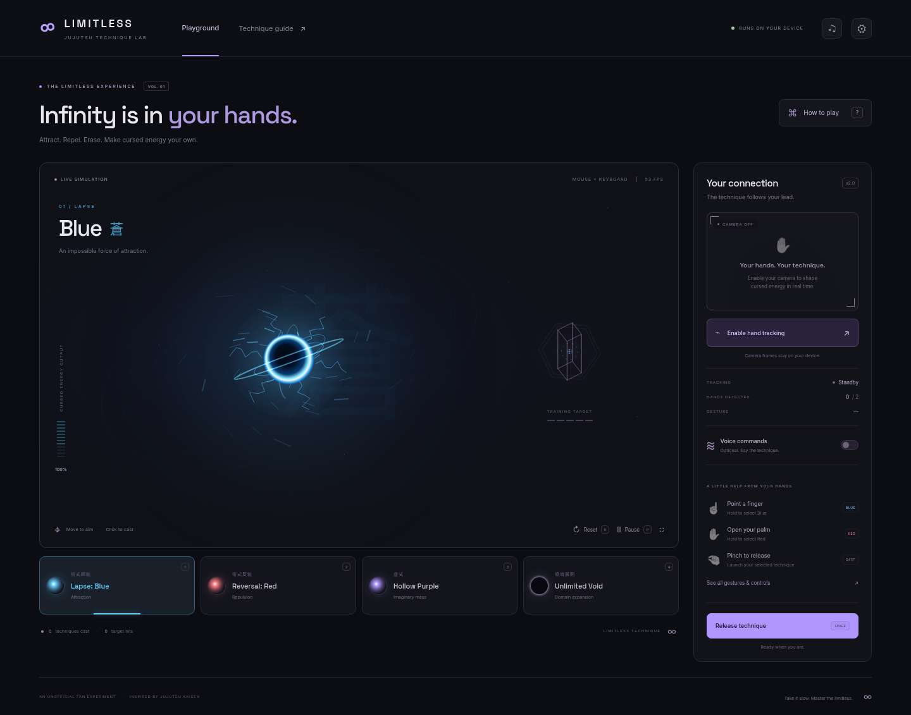

# Limitless · jjk-open

A Jujutsu Kaisen inspired cursed-technique playground. Shape Blue, Red, Hollow Purple, and Unlimited Void with your hands — or use your mouse, keyboard, and touch.



## Run

Requires Node.js **22.13+** and npm.

```sh
git clone https://github.com/yadavayush834/jjk-open.git
cd jjk-open
npm ci
npm run dev
```

Open the localhost URL printed by Vite. The first start downloads the hand model from Google and copies the installed MediaPipe runtime locally. Subsequent runs use local assets; no API keys, CDN scripts, or external fonts are required.

```sh
npm run build
npm start                    # http://localhost:5010
./scripts/install-desktop.sh  # optional Linux app launcher
```

## Techniques and controls

| Technique      | Keyboard | Hand gesture                                          |
| -------------- | -------- | ----------------------------------------------------- |
| Lapse: Blue    | **1**    | Hold one index finger up                              |
| Reversal: Red  | **2**    | Hold an open palm                                     |
| Hollow Purple  | **3**    | Pinch with both hands close together and hold         |
| Unlimited Void | **4**    | Hold index and middle fingers up for about one second |

**Space** or click the stage to cast; move the pointer to aim. Pinch thumb and index to launch the selected technique, then release before another cast. **R** resets, **P** pauses, **F** toggles fullscreen, and **?** opens the guide. Buttons also work on touch screens.

Camera and voice are separate, optional controls. Enabling hand tracking requests video only. Tracking uses a local model in a worker, capped at 12.5 updates/sec, with position smoothing, stable hand IDs, held poses, and pinch hysteresis. Settings include low/balanced/high quality, reduced motion, gesture selection, and a mirrored camera stage.

[Hollow Purple](docs/screenshots/purple.png) · [Unlimited Void](docs/screenshots/domain.png) · [Phone layout](docs/screenshots/mobile.png)

## What changed

- A completely new interface with technique cards, training target, cooldowns, guide, and device feedback.
- Distinct attraction, repulsion, fusion, projectile, impact, and domain animations with time-based simulation.
- Hand inference runs outside the render thread. No face model, duplicate camera request, or fake “ready” state after tracker failure.
- Lost hands expire; reacquiring a pinched hand does not accidentally launch a technique. Denied permissions leave manual controls available.
- Local fonts include Japanese glyphs; high-density canvas rendering and reduced-motion settings are supported.

Camera frames are processed on your device and are not uploaded by this app. Browser speech recognition may use an online browser service and is not available everywhere. Camera access needs localhost or HTTPS. Good lighting and a fully visible hand improve detection; real-world tracking depends on your camera and hardware.

## Verify

```sh
npm test
npm run build
npx playwright install chromium  # once for browser tests
npm run test:e2e
npm run format:check
```

16 simulation/gesture tests cover refresh-rate independence, projectiles, timing, lost hands, identity, smoothing, deliberate gestures, and projection. Four browser tests exercise the techniques, a real model/worker with a synthetic camera, device cleanup, permission failure, and mobile/settings flows. Test camera footage is synthetic; no personal camera images are captured in screenshots.

Original procedural effects and interface; an unofficial fan project, not affiliated with the creators of Jujutsu Kaisen. No anime footage or official character artwork is used by the application. [Credits](CREDITS.md) · [Development notes](AGENTS.md)
